<p align="center">
  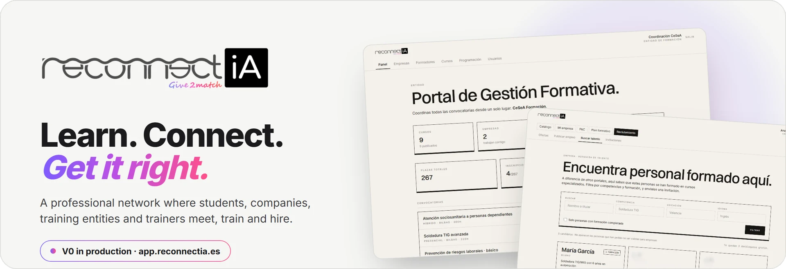
</p>

<p align="center">
  <a href="https://app.reconnectia.es"><b>app.reconnectia.es</b></a> ·
  <a href="https://reconnectia.es">reconnectia.es</a> ·
  <a href="#build-progress">Progress</a> ·
  <a href="#architecture">Architecture</a> ·
  <a href="#security">Security</a> ·
  <a href="platform/">Code</a> ·
  <a href="https://github.com/vaultbit-web/RECONNECTIA-WEBSITE">Website source</a>
</p>

<p align="center">
  
  
  
  
  
  
  
  
</p>

# Reconnect.iA

Reconnect.iA is a professional network for the training and social-care sector in Spain. The idea behind it is simple: if you can prove your training, it should help you get hired. Students, companies, accredited training entities and trainers all work on the same platform.

A student's profile works as a CV that fills itself in with the courses they finish, the skills they validate and the assessments they decide to share. Companies look for people who have actually been trained, publish job offers ranked by affinity and manage their FUNDAE (subsidised) training plans. Training entities schedule course deliveries and assign validated trainers to them. Trainers pick the deliveries that suit them and run their classes from their own panel.

I designed and built the platform from scratch as its lead full-stack developer. That covers the architecture and the data model, the six role experiences, an internal points economy, the bridge to the operator's own learning platform, the security hardening, the marketing site and the internal tooling. It has been live since 7 June 2026. CeSeA Sistemas runs it, and CeSeA Formación is the first training provider on it.

## Build progress

<picture>
  <source media="(prefers-color-scheme: dark)" srcset="docs/progress/progress-dark.svg">
  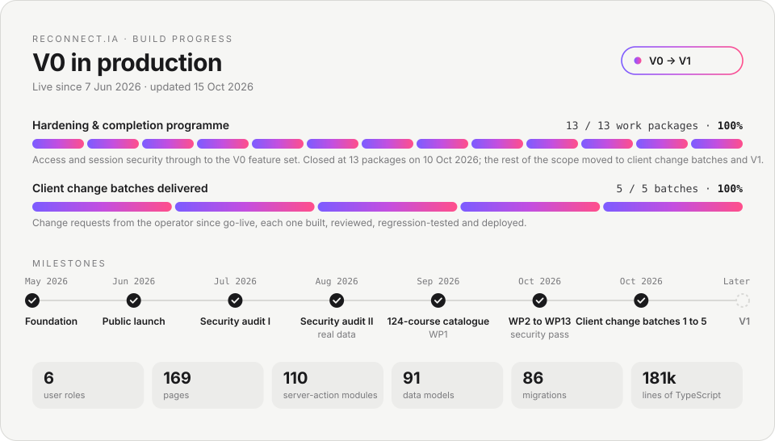
</picture>

<!-- progress:start -->
_Last updated 28 Sep 2026 · V0 in production since 7 Jun 2026._

| Track | Progress | |
|---|---|---|
| V0 features built | 268 / 324 features | **83%** |
| Hardening & completion programme | 1 / 17 work packages | **6%** |
<!-- progress:end -->

The card and both tables come from [`roadmap.json`](roadmap.json). When a milestone lands I edit that file and run [`tools/progress.mjs`](tools/progress.mjs), which redraws the card and rewrites these sections.

## Six roles, one network

| Role | What they do here |
|---|---|
| Student | Keeps a CV built from completed courses and validated skills, plus an external CV, certificates and ECOE exam results. Can take the ACAT behavioural test and the EROP projective test, both behind informed consent and private unless shared. Sees job offers ranked by affinity, course recommendations and two wallets (SkillPoints and TimePoints). |
| Company | Has a company page, publishes jobs on a plan and sees candidates ranked by affinity. Searches talent with a limited number of free unlocks, follows the people it hired and whatever results they chose to share, builds a training plan with trusted entities and keeps its FUNDAE credit and paperwork. |
| Training entity | Runs a training portal: course calls, catalogue, delivery scheduling, trainer validation, enrolments, client companies, a small CRM of care homes and its own staff accounts. A new entity waits in a holding screen until an administrator validates it. |
| Trainer | Has a professional profile and a calendar, swipes through course deliveries to say which ones they want, and uses a delivery panel for attendance, logbook, hours, incidents, tasks and ratings. |
| Administrator | Has a control panel with platform KPIs, moderates users, entities and companies, manages the catalogue and deliveries, runs the SkillPoints economy (prices, wallets, disputes) and reads the audit log. |
| Everyone | Registration by role, email verification, password recovery, the public home and the legal pages. |

## Screenshots

These come from a local copy of the platform filled with made-up data, so no real person appears in them.

<table>
  <tr>
    <td width="50%">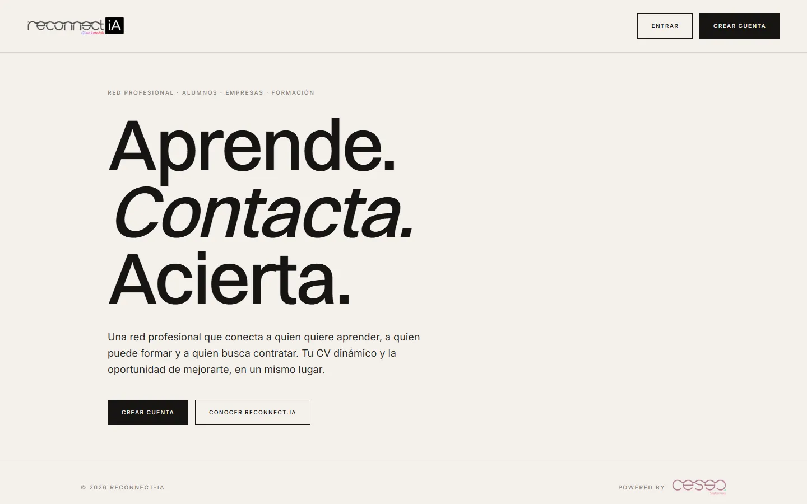<br><sub><b>Public home.</b> Learn, connect, get it right, with sign-up by role one click away.</sub></td>
    <td width="50%">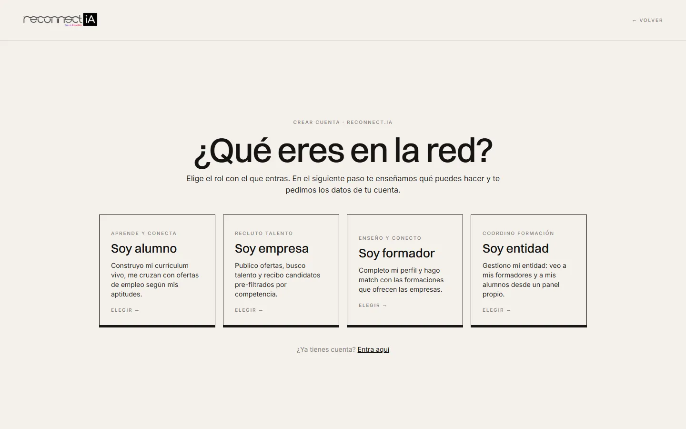<br><sub><b>Registration.</b> Each role has its own onboarding and asks for its own data.</sub></td>
  </tr>
  <tr>
    <td width="50%">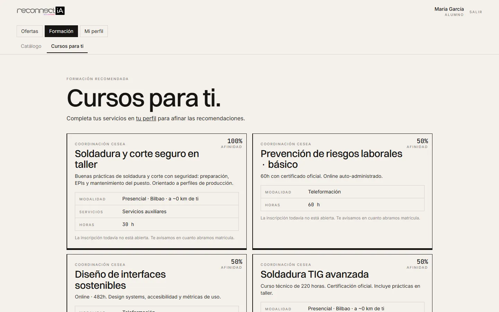<br><sub><b>Student, courses for you.</b> Scored against the student's services and location, per delivery mode.</sub></td>
    <td width="50%">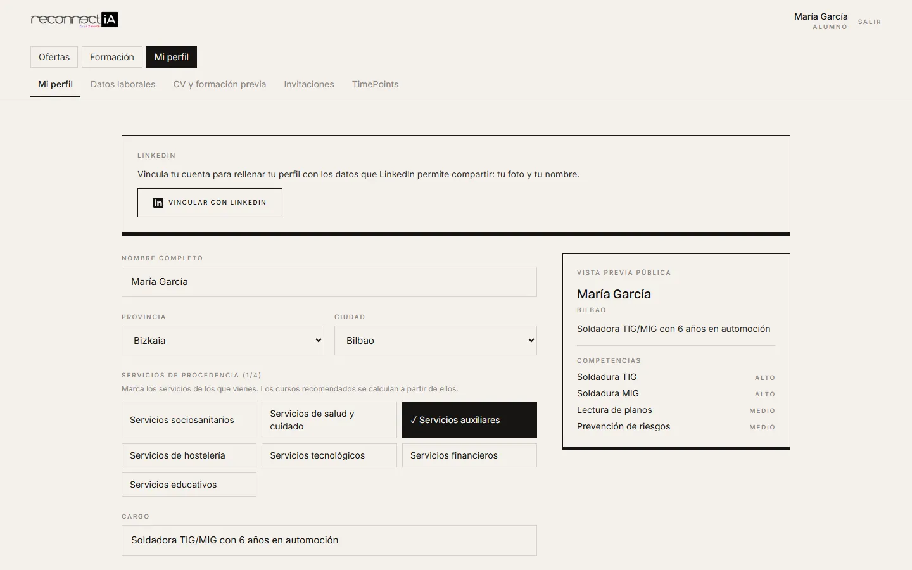<br><sub><b>Student profile.</b> The card companies see, built around completed training and validated skills.</sub></td>
  </tr>
  <tr>
    <td width="50%">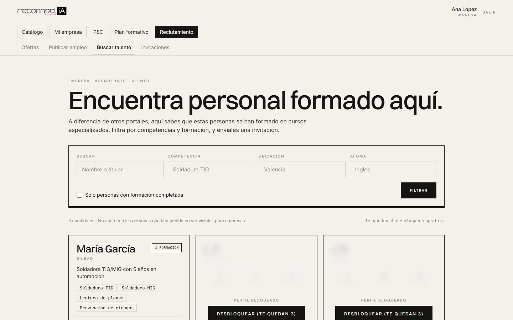<br><sub><b>Company, talent search.</b> Filter by skill and training. Profiles unlock from a free quota or with SkillPoints.</sub></td>
    <td width="50%">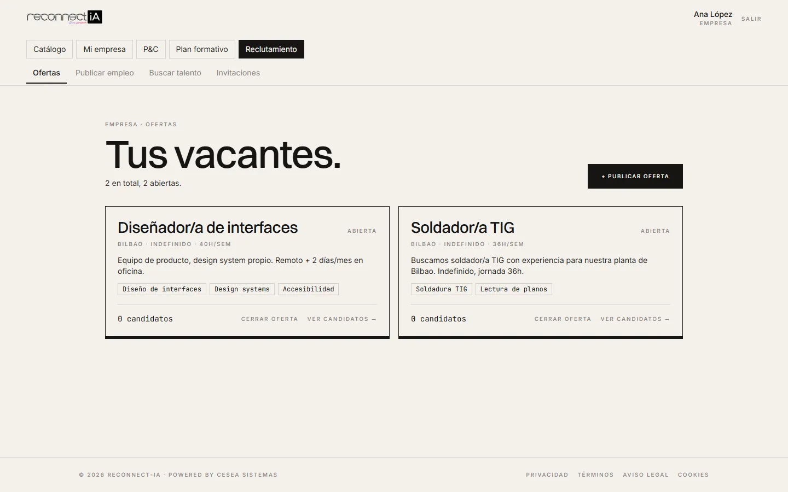<br><sub><b>Company, vacancies.</b> The skills an offer asks for drive the affinity ranking.</sub></td>
  </tr>
  <tr>
    <td width="50%">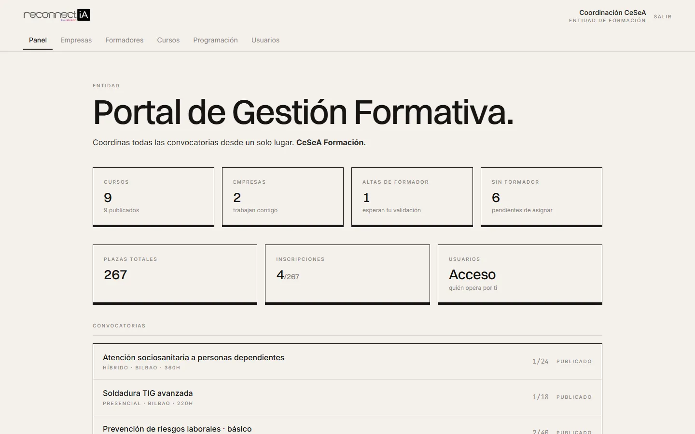<br><sub><b>Training entity portal.</b> Courses, companies, trainers waiting for validation and deliveries still without a trainer.</sub></td>
    <td width="50%">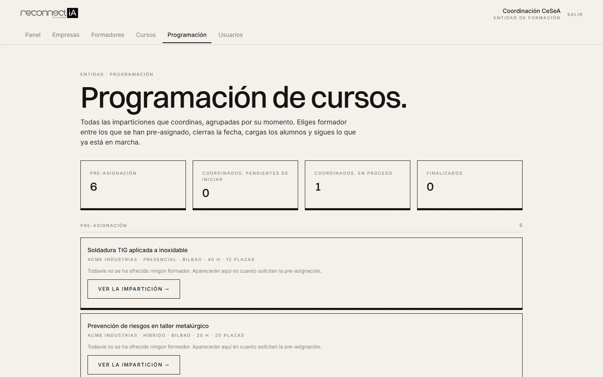<br><sub><b>Scheduling.</b> Deliveries grouped by stage, from pre-assignment to finished.</sub></td>
  </tr>
  <tr>
    <td width="50%">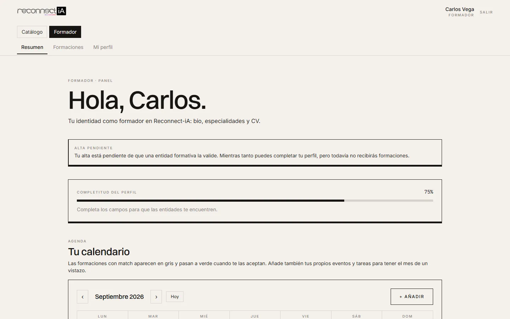<br><sub><b>Trainer home.</b> Validation status, how complete the profile is, and the calendar.</sub></td>
    <td width="50%">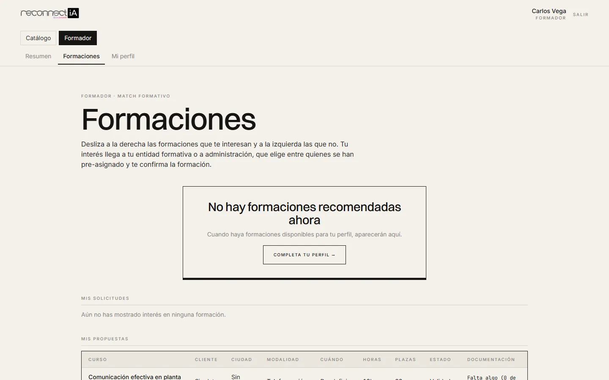<br><sub><b>Trainer matching.</b> Swipe right on the deliveries you want and the entity confirms.</sub></td>
  </tr>
  <tr>
    <td width="50%">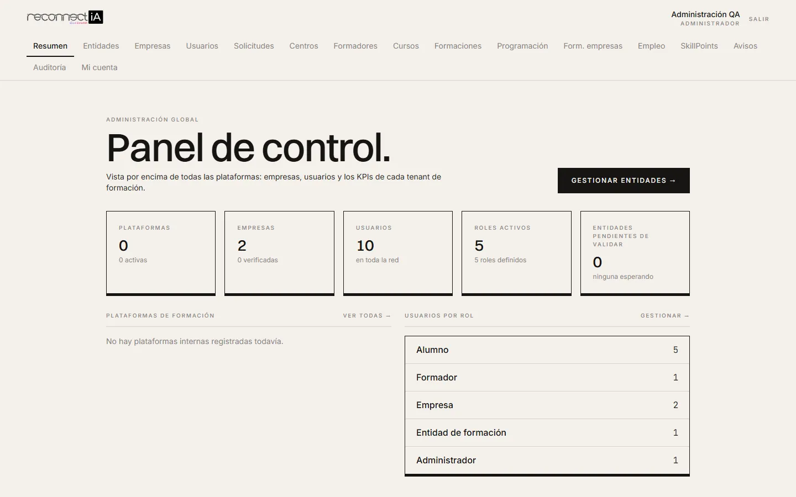<br><sub><b>Admin panel.</b> Platform KPIs, users by role and entities pending validation.</sub></td>
    <td width="50%">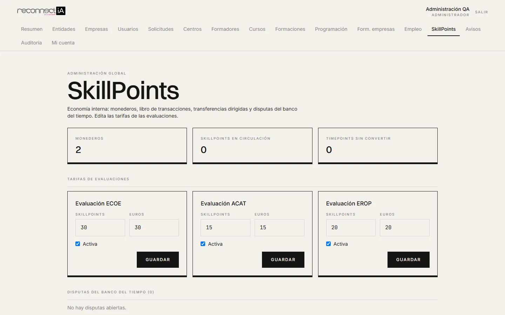<br><sub><b>SkillPoints.</b> Wallets, points in circulation, assessment prices and disputes.</sub></td>
  </tr>
</table>

## The landing page

[reconnectia.es](https://reconnectia.es) explains the network as you scroll, one scene at a time, and also hosts the product manual. It is plain JavaScript with GSAP ScrollTrigger and Lenis copied into the site, so it loads no script from a CDN. It started as a countdown to launch day and became the way into the platform. Its source is public in [vaultbit-web/RECONNECTIA-WEBSITE](https://github.com/vaultbit-web/RECONNECTIA-WEBSITE).

<table>
  <tr>
    <td width="33%">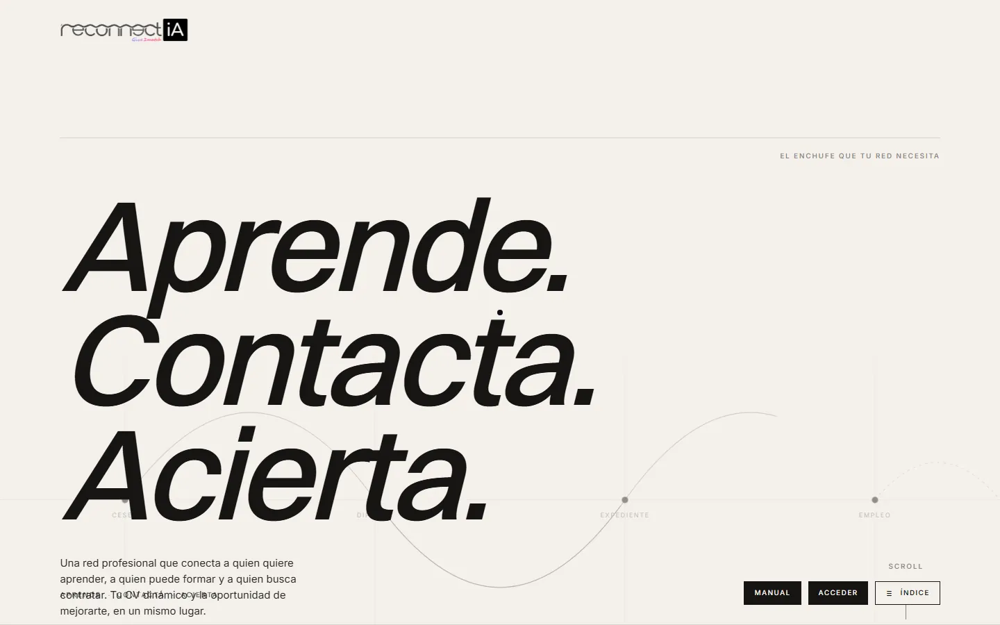</td>
    <td width="33%">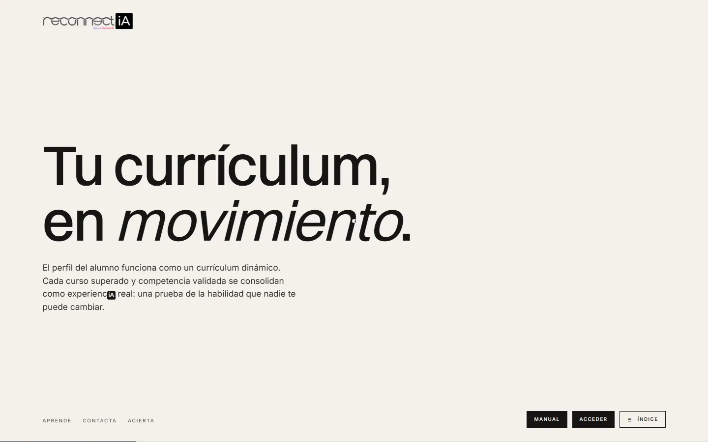</td>
    <td width="33%">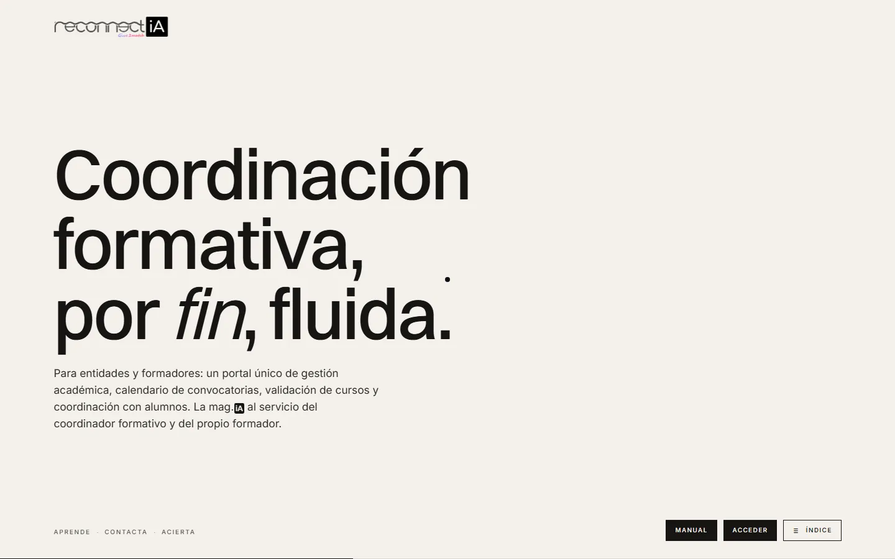</td>
  </tr>
  <tr>
    <td width="33%">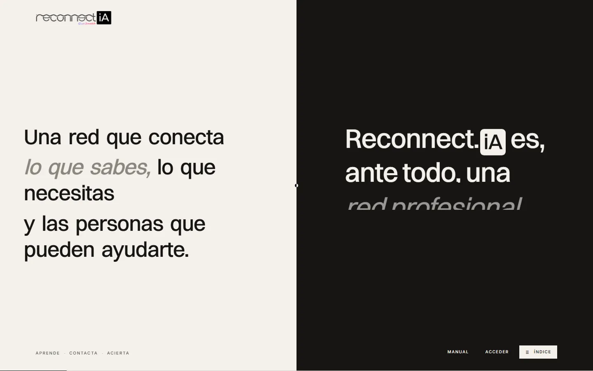</td>
    <td width="33%"></td>
    <td width="33%"></td>
  </tr>
</table>

## Stack

| Layer | Choice |
|---|---|
| Framework | Next.js 16 (App Router, Turbopack), React 19.2 |
| Language | TypeScript in strict mode |
| Data | PostgreSQL with Prisma 6: 59 models, 38 migrations |
| Auth | Auth.js v5 with credentials and bcrypt, JWT sessions that carry a per-user version |
| Forms and validation | Zod 4 on the server, React Hook Form in the browser |
| Styling | Tailwind CSS 4 with design tokens, Inter and JetBrains Mono through `next/font` |
| Files and email | Private object storage behind route handlers, Nodemailer with branded templates |
| Integrations | Single sign-on into the operator's learning platform with a short-lived signed JWT, spreadsheet import of students and trainers |
| Testing | `node:test` with `tsx`, plus an acceptance harness that drives headless Chrome |
| Delivery | Docker image behind a reverse proxy, redeployed on every push to `main` |

## Architecture

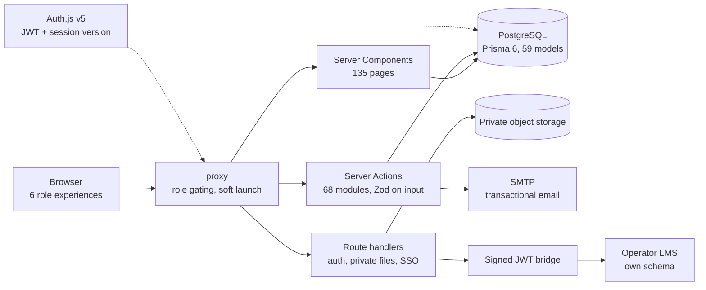

A few decisions explain most of the code.

All writes go through Server Actions. Input is parsed with Zod, each action starts with a role guard, and anything that touches more than one row (wallet debits, enrolments, hiring) runs in a database transaction.

The schema only grows. New columns arrive nullable or with a default, backfills live inside the migration, and references between unrelated modules have no foreign key on purpose, so a module can ship without rewriting data.

A company can run its own learning platform in a separate Postgres schema. `InternalPlatform` describes that tenant (schema, branding, features, how it is embedded) and `InternalPlatformMembership` links a Reconnect.iA user to their identity inside it. A short-lived signed JWT takes them across without a second login.

There is an internal economy. SkillPoints (1 Skp is worth 1 euro) sit in wallets backed by a transaction ledger, with transfers between users and a dispute flow. TimePoints run a time bank between members. Assessments and talent unlocks are priced in SkillPoints from a table the admin can edit, and job publishing works with plans.

Matching has to be explainable. A candidate's affinity for a job is the share of required skills they have (50 when the offer asks for none). For trainers, a services match is multiplied by a distance factor that depends on the delivery mode: online ignores distance, in-person decays as e^(−km/430) between provinces, and hybrid sits halfway. Any score can be shown with its reasons.

Personal data is private by default. Assessment results stay hidden until the student shares them, students can leave the talent search, and a trainer's tax and bank details live in a separate table that only the owning entity and administrators can query.

Routes open per role from a single allowlist, so a module can be finished in production and switched on when it is ready. The operator's catalogue (124 courses) is imported from its public site by a script that refuses to run if the course count changed unexpectedly.

### Core data model

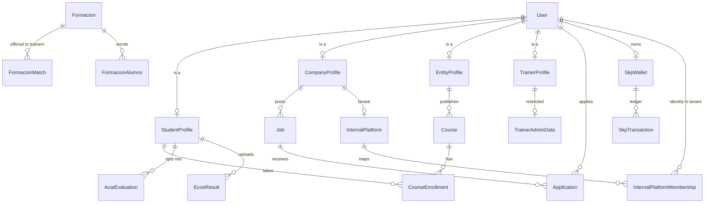

## Security

The platform holds employment records and assessment results of real people, so I treat security as part of the product work.

Two security audits ran in July and August 2026. Every finding was fixed and deployed, from the assessment paywall and atomic wallet writes to the SSO bridge and email verification.

Sessions can be revoked. The JWT carries a version number that is checked against the database on every request, with a 10-second cache per process. Changing, resetting or rotating a password bumps the version, so all other sessions end straight away while the user's own session is issued again.

One-time links only work for their own purpose. Verification, invitation and password-reset tokens share a table, so the purpose travels inside the token (`ver_`, `inv_`, `rst_`) and each screen only accepts its own kind. A stolen confirmation link cannot be used to set a password.

Rate limits use a client IP that cannot be spoofed: the address N hops from the right of `X-Forwarded-For`, where N is the number of proxies we control, never the left-most value that the client writes. If the setting is missing, the app says so when it boots.

Anyone can register a training entity, but its portal does nothing until an administrator validates it, and that decision is logged and emailed.

CVs, certificates and exam results are never in a public bucket. A route handler serves them to their owner, or to a company that hired the student and only if the student turned sharing on.

Every script that touches a database resolves it through the same guard. Production needs an explicit flag and variables with different names, migrations run through a script with its own checks, and the old destructive seeders are gone from the repository. Password rotation creates a different random password per account and writes it once outside the project folder. The database only stores bcrypt hashes.

## Quality

The security-critical modules have unit tests with `node:test` and `tsx`. The samples published here run on their own: 5 suites, 35 tests. An acceptance harness drives headless Chrome over the DevTools protocol against a production build and covers 12 scenarios, including registration, email verification, login, session invalidation and entity validation. QA and demos use a local database with made-up data, kept away from production by the same guard, and the whole app passes a strict TypeScript check.

## Code

The [`platform/`](platform/) folder has the full data model (59 models), interface components such as the trainer's swipe deck and the calendar, the design tokens, the email templates and the security modules with their tests, which run on their own. [`platform/README.md`](platform/README.md) goes through each file.

The rest of the source stays private. It is a live system with personal and employment data, and publishing all of it would hand out its attack surface.

## Roadmap

<!-- roadmap:start -->
| When | Milestone | Status | What shipped, or what comes next |
|---|---|---|---|
| May 2026 | Foundation | Done | Next.js 16 + Prisma + Auth.js scaffold, first three roles, job offers, courses and affinity matching, ACAT and ECOE in the student profile, trainer role. |
| Jun 2026 | Public launch | Done | Live on 7 June. Unified contextual navigation, legal pages, residence CRM for training entities, trainer ↔ course matching, branded transactional email. |
| Jul 2026 | Security audit I | Done | Audit remediation (evaluation paywall, atomic writes, SSO, email verification), training modalities, catalogue filters, supervised labour profile. |
| Aug 2026 | Security audit II · real data | Done | Second audit fixed and deployed, password recovery, training-entity portal, bulk student import, move from demo data to the real catalogue. |
| Sep 2026 | 124-course catalogue · WP1 | Done | Full CeSeA Formación catalogue imported with drift checks. Work package 1: versioned sessions, purpose-bound tokens, trusted client IP, entity validation, tests and acceptance harness. |
| Next | WP2 to WP17 | In progress | Next work packages towards V1: onboarding and validation flows for every role, course scheduling and delivery, reporting. |
| Later | V1 | Planned | Semantic matching, in-app messaging, online payments and offer packs, automated ECOE validation, full back office, mobile app. |
<!-- roadmap:end -->

## Repository layout

```
docs/          brand, screenshots and the progress cards
platform/      data model, interface components and platform modules with their tests
roadmap.json   milestones and progress, the source for the card above
tools/         script that draws the progress card and updates this README
```

---

Designed and built by **Daniel Brosed**, full-stack developer and security auditor.
[danielbrosed.com](https://danielbrosed.com) · [LinkedIn](https://www.linkedin.com/in/danielbrosed/)

Reconnect.iA is run by CeSeA Sistemas. This repository is a portfolio case study: screenshots use made-up data and the platform is represented by a selection of its modules. See [`LICENSE`](LICENSE).
